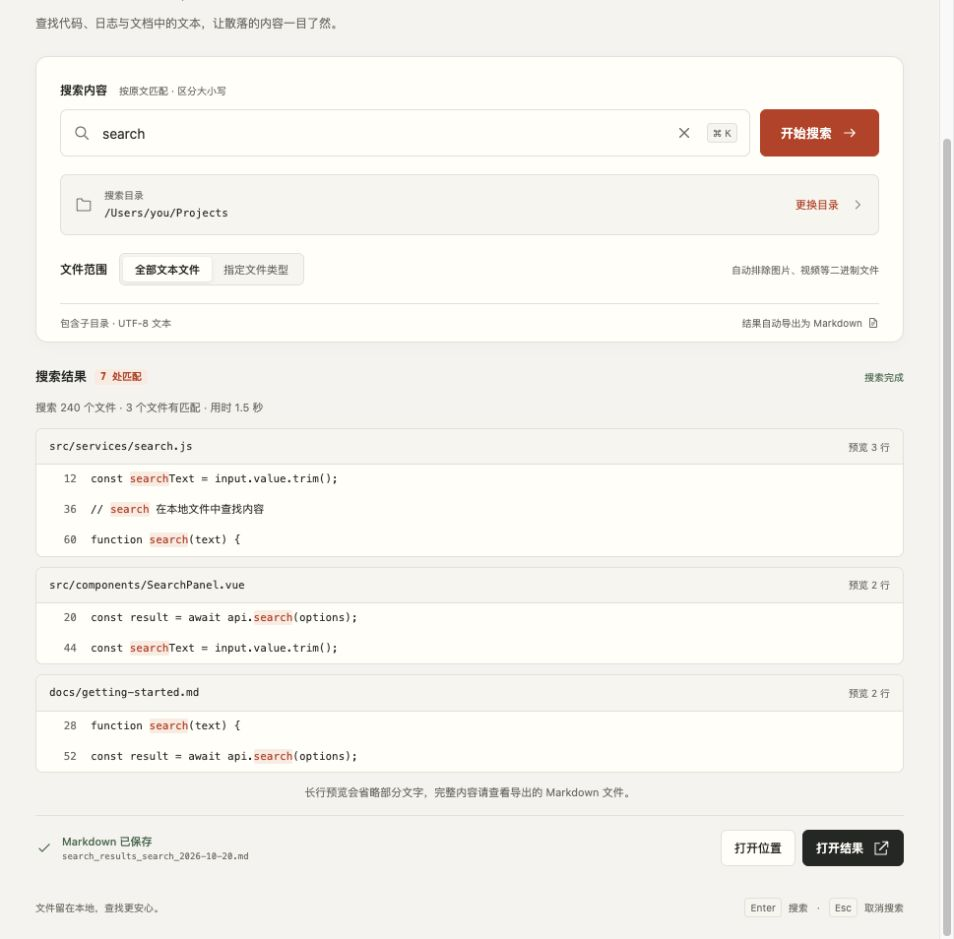
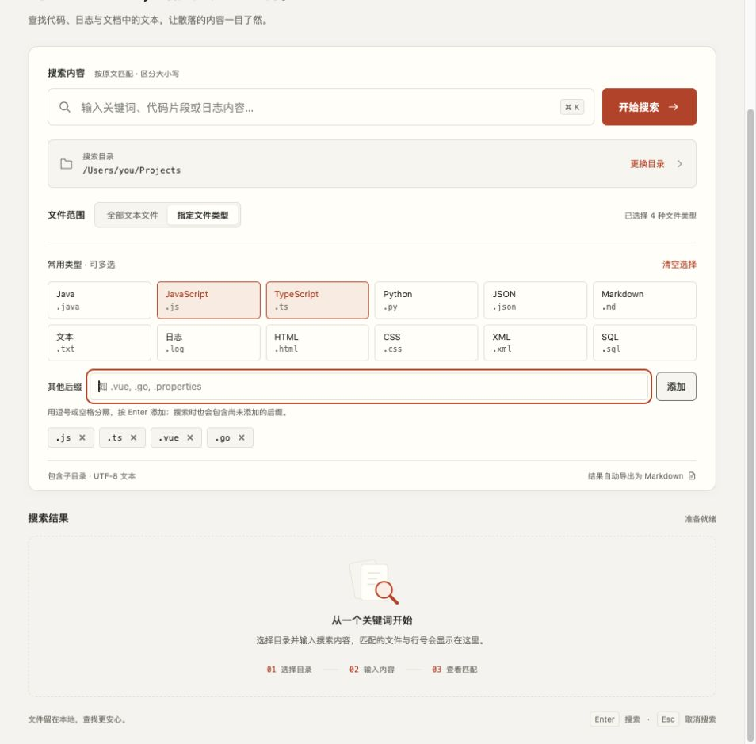

# Find In Files - uTools 文件内容搜索插件

## 📌 简介

Find In Files 是一款强大的 uTools 插件，用于在指定目录下批量搜索文件内容，并将搜索结果以 Markdown 表格格式输出。适用于代码审查、日志分析、文档查找等多种场景。

## ✨ 主要特性

- 🔍 **全文搜索**：在指定目录及其子目录下搜索包含特定文本的文件
- 📁 **灵活的文件类型过滤**：支持全量搜索或指定文件后缀搜索
- 📊 **结构化输出**：搜索结果以 Markdown 表格格式保存，便于查看和分享
- 🎯 **智能项目识别**：自动识别文件所属项目名称
- 📈 **实时进度显示**：搜索过程中实时显示进度和统计信息
- 💾 **自动保存结果**：搜索结果自动保存到下载目录
- 📝 **页内浏览**：按文件分组展示并高亮匹配行，首批显示 100 行，可继续加载、折叠文件或展开长行
- 📍 **结果操作**：打开原文件或所在位置，复制完整路径与匹配行
- 🔄 **连续搜索**：新搜索成功后再替换结果，取消或失败时保留上一轮结果，并标明关键词、目录与文件范围
- ⌨️ **快捷操作**：Enter 搜索，Esc 取消，⌘/Ctrl + K 聚焦搜索框
- 🎨 **自适应界面**：适配窄窗口，并随系统切换浅色、深色主题

## 🚀 安装方法

### 方式一：插件商店安装
1. 打开 uTools
2. 进入插件商店
3. 搜索 "FindAnyThingInFile"
4. 点击安装

### 方式二：开发者模式安装
1. 下载本项目所有文件
2. 打开 uTools 开发者工具
3. 点击"新建插件"，选择项目目录
4. 完成安装

## 📖 使用教程

### 1. 启动插件

打开 uTools，输入以下任一关键词启动插件：
- `find`
- `搜索文件`
- `搜索Java文件`
- `文件内容匹配`


### 2. 基本搜索操作

#### 步骤 1：输入搜索内容
在搜索框中输入要查找的文本内容。按原文匹配，区分大小写，不使用正则表达式。


#### 步骤 2：选择搜索模式

- **全部文本文件**：搜索目录下的文本文件，按后缀排除常见二进制文件
- **指定文件类型**：多选常用类型，或手动添加后缀；至少需要选择一种类型

#### 步骤 3：设置搜索路径
点击目录区域选择要搜索的根目录。首次使用需要先选择目录，之后自动恢复上次的目录与文件类型设置。

#### 步骤 4：执行搜索
点击"开始搜索"或在搜索框按 Enter。搜索区上方显示扫描、搜索和保存进度，滚动查看结果时仍可看到任务状态；搜索过程中可点击"取消搜索"或按 Esc，取消后不会导出本次结果。保存文件阶段不再接受取消。

新搜索期间仍可浏览上一轮结果；取消或失败后也会保留。结果上方显示对应的关键词、目录与文件范围，避免与正在输入的条件混淆。目录错误时可直接重新选择目录；无匹配时可修改关键词，指定类型搜索还可一键改搜全部文本文件。

### 3. 查看搜索结果

搜索完成后，页面会显示匹配文件数、匹配行数和耗时。匹配结果按文件分组展示并高亮关键词，首批显示 100 行；点击"再显示"继续追加结果，已经展开的长行和文件折叠状态会保留。

- 点击文件名，用系统默认应用打开原文件；文件标题旁可打开所在位置或复制完整路径
- 点击文件标题左侧的箭头折叠或展开该文件的匹配行
- 长行默认显示匹配位置附近的内容，点击"展开"查看全文，或点击"复制行"复制完整匹配内容
- 点击"浏览结果"聚焦第一个文件；使用 Tab 浏览操作，Enter 打开聚焦的文件或执行按钮操作



- **打开位置**：打开文件所在文件夹并选中结果文件
- **打开结果**：用系统默认应用打开完整的 Markdown 文件
- **重新保存 Markdown**：仅在导出失败时出现。修复下载目录权限或磁盘空间后，可直接重试，无需重新搜索

无法读取的文件或子目录会跳过，并在结果摘要中提示。目录本身无法读取时显示错误；搜索不会自动跟随符号链接。没有匹配时仍导出一份说明文件。

文档截图为旧版界面的示例目录与模拟结果；当前布局及新增操作以上述说明为准，实际文件数量和路径以本地搜索为准。

### 4. 结果文件格式

搜索结果以 Markdown 表格形式保存，包含以下信息：

| 项目名 | 文件名 | 文件类型 | 行号 | 内容 |
| ------ | ------ | -------- | ---- | ---- |
| project1 | Main.java | .java | 15 | public static void main(String[] args) |
| project2 | config.xml | .xml | 8 | <property name="searchText" value="example"/> |


## 🎯 使用场景

### 场景一：代码审查
快速查找项目中所有调用特定方法或包含特定关键词的代码位置。

### 场景二：日志分析
在大量日志文件中搜索错误信息或特定事件。

### 场景三：配置查找
查找所有配置文件中的特定配置项。

### 场景四：文档搜索
在文档库中查找包含特定内容的文档。

## ⚙️ 高级功能

### 自定义文件类型

除了使用预设的常用文件类型外，还可以手动输入自定义后缀：



支持的输入格式：
- `.ts,.vue,.go` （推荐）
- `ts,vue,go` （自动补充点号）
- 混合输入：`.ts,vue,.go`
- 也可使用中文逗号或空格分隔，后缀会自动转为小写并去重

按 Enter 或点击"添加"确认后缀后，才会生成已选标签并保存设置。输入框中的未确认内容会单独提示，开始搜索时也会自动确认有效输入。点击标签的删除按钮可移除单项，点击"清空选择"可重置已确认类型和当前输入。

已保存的自定义类型默认收起，可通过"调整类型"展开；开始搜索后会收起类型面板。目录旁的"复制目录"可复制完整搜索路径。

### 搜索状态实时显示

搜索过程中会实时显示：
- 扫描进度
- 已处理文件数
- 已找到的匹配文件数
- 当前处理状态

## 🔧 配置说明

插件会自动保存以下配置：
- **搜索路径**：上次使用的搜索目录
- **文件范围和后缀**：上次使用的搜索模式与已确认的后缀
- 配置存储位置：uTools 本地数据库

## ⚠️ 注意事项

1. **文件类型限制**：插件会自动排除以下二进制文件类型：
    - 图片：`.jpg`, `.jpeg`, `.png`, `.gif`, `.bmp`, `.webp`, `.svg`
    - 视频：`.mp4`, `.avi`, `.mov`, `.wmv`, `.flv`, `.mkv`, `.webm`
    - 音频：`.mp3`, `.wav`, `.aac`, `.ogg`, `.flac`
    - 压缩包：`.zip`, `.rar`, `.7z`, `.tar`, `.gz`, `.bz2`, `.xz`
    - 可执行文件：`.exe`, `.dll`, `.so`, `.bin`, `.dat`, `.apk`, `.iso`
    - 办公文档：`.pdf`, `.doc`, `.docx`, `.ppt`, `.pptx`, `.xls`, `.xlsx`

2. **大文件处理**：采用异步目录扫描和逐行读取；结果仍保存在内存中，匹配内容非常多时会占用较多内存

3. **文件编码**：目前仅支持 UTF-8 编码的文本文件

4. **结果文件命名**：结果文件命名格式为 `search_results_[清理后的搜索内容]_[时间戳]_[随机后缀].md`

5. **隐私**：搜索和导出均在本地完成。导出文件名含有搜索内容，文件内含有匹配行；分享前请检查是否含敏感信息

## 🛠️ 技术栈

- **前端**：HTML5 + CSS3 + 原生 JavaScript
- **后端**：Node.js (uTools preload)
- **文件系统**：Node.js fs 模块
- **UI 框架**：自定义 CSS 样式

## 🤝 贡献指南

欢迎提交 Issue 和 Pull Request！

### 开发环境搭建
1. 克隆项目到本地
2. 安装 uTools 开发者工具
3. 在开发者工具中加载项目
4. 修改代码并测试

### 检查与测试

无需安装依赖或执行构建，使用 Node.js 18 及以上运行：

```sh
node --check index.js
node --check preload.js
node --test tests/*.test.js
git diff --check
```

测试使用临时目录、模拟的 uTools API 和轻量 DOM，覆盖搜索、取消、权限异常、文件操作，以及连续搜索结果保留、后缀确认、增量浏览、错误恢复和导出重试。文件打开使用 [uTools 系统 API](https://www.u-tools.cn/docs/api-reference/system.html)，文本复制使用 [uTools 复制 API](https://www.u-tools.cn/docs/developer/api-reference/utools/copy.html)。实际目录选择、剪贴板、键盘默认行为及系统文件打开仍需在 uTools 中验证。直接用浏览器打开页面可检查布局，但无法搜索本地文件。

修改界面后，在 uTools 开发者工具中重新加载插件，检查浅色/深色主题、窄窗口、空输入、空结果和键盘操作。

### 代码结构
```
find_and/
├── index.html          # 主界面
├── index.css           # 样式文件
├── index.js            # 前端逻辑
├── preload.js          # 后端逻辑
├── plugin.json         # 插件配置
├── logo-v2.png        # 插件图标（256×256 PNG）
├── tests/             # Node.js 内置测试运行器的回归测试
├── docs/images/       # 界面示例截图
└── README.md          # 说明文档
```

插件图标使用 [logo-v2.png](./logo-v2.png)，尺寸为 256×256 像素。生成方式和完整提示词见 [图标生成说明](./docs/logo-generation.md)。

## 📄 开源协议

MIT License

## 👨‍💻 作者

dongkun

## 💬 反馈与支持

如有问题或建议，请通过以下方式联系：
- 在 uTools 插件评论，联系作者
- 提交 GitHub Issue

## 🙏 致谢

感谢 uTools 提供的优秀插件平台！

---

**快速开始**：打开 uTools → 输入 `find` → 开始搜索！
